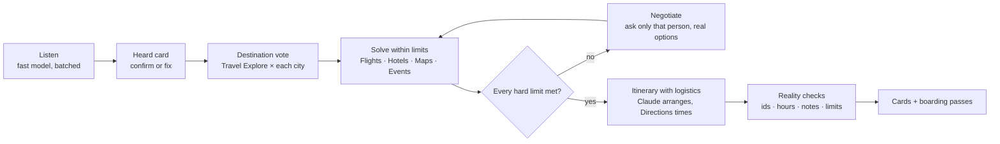

# Milo

**The trip planner that lives in your group chat: add Milo to the trip group, keep chatting, and it plans a trip that works for everyone, from real Google results.**

Built for the SerpApi India Hackathon 2026 · Travel & Local Discovery.

## The problem

A 2026 survey found that **76% of group trips never make it out of the group chat** (Talker Research). Everyone says *chalo!*, then the plan dies, because each friend's limits are scattered across the messages: Ishita's budget is "15k max", Kabir has "office till 6 on Friday", Meera is veg. Nobody wants to be the planner who has to collect all that, search flights from four cities and find something that fits everyone.

## What Milo does

Add Milo to the group and it plans like a real planner:

1. **Listens.** People chat normally. Milo reads the messages in batches, picks up each friend's limits (home city, dates, budget cap, food needs, flight times, must-dos, vibe) and reacts 👀 to the messages it learned from. It stores only the extracted limits, never message text.
2. **Shows "Here's what I heard."** One card with everyone's limits, hard ones marked 🔒. Only you can fix your own row.
3. **Finds where the squad can afford to go and lets the group vote.** Google Travel Explore from every home city, real hotel prices, then a vote with proxy votes, deadlines, tie-breaks and vetoes.
4. **Searches within every person's limits.** Per-person flight searches respect their time limits; hotels are capped by the tightest budget. If something has to give, **only the person affected is asked**, with 2–3 real options and real numbers: *"Ishita, Goa comes to ₹21,600 for you, ₹6,600 over your cap. A: your cheapest flights + a cheaper stay → ₹12,560…"*
5. **Builds the trip with real logistics.** Flights that land together at the same airport, a hotel near the action, days that stay in one area, real Google Maps drive times, leave-by times, sunset timing and a veg meal every day when someone's veg.
6. **Ends with a boarding pass for each friend** showing why the plan works for them: *"Flight leaves DEL 18:35, after 18:00 (office till 6 on Friday) ✓"*.

Users never type commands: it's natural language and buttons, with a pinned Trip card that tracks the stage, decisions and what's pending.

## How it works



**No fakes.** Every flight, hotel, place and event is a real SerpApi result. Claude only chooses and arranges candidates by id; code checks every id against the search results and removes anything else. Milo's notes may only use facts from that place's own Google data (no invented numbers, names or superlatives, and a tribute concert is never "the artist performing"). Places marked closed or with under 100 reviews are dropped, stops must fall inside opening hours, and events must be dated inside the trip, in the destination, with a link. Every hard limit is checked for every person in code, never by the AI alone. A **See sources** button lists every search and every dropped item with its reason.

## SerpApi engines

| Engine | What Milo uses it for |
|---|---|
| `google_travel_explore` | Where every friend's city can fly to in India, with round-trip fares (the destination shortlist) |
| `google_flights` | One-way flights per person and direction, with `outbound_times` for limits like "no flights before 8am"; the land-together optimiser picks the combination |
| `google_hotels` | Hotels capped by the tightest budget; check-in/check-out times; cheaper stays when someone's over budget |
| `google_maps` | Attractions, restaurants, cafes, interests, veg/Jain food searches and named must-dos, with hours and reviews |
| `google_maps_directions` | Real airport transfers and hop times between stops (capped at 12 per plan, cached) |
| `google` (`events_results`) | Events during the trip, kept only when dated, in the destination and linked |

All calls go through one client with a disk cache and recorded demo mode, so re-running a plan costs nothing.

## Run it

You need Node 20+ and a Telegram account.

```bash
git clone <this repo> milo && cd milo
npm install
npx playwright install chromium
cp .env.example .env.local
```

### Try it without any keys (demo mode)

The repo includes a recorded real run in `demo-data/` (39 real responses). The simulator plays the whole demo through Milo's real handlers with a fake Telegram, using only chat messages and button taps:

```bash
DEMO_MODE=true npm run simulate
```

### Run the real bot

1. In Telegram, open **@BotFather** → `/newbot` → copy the token.
2. In @BotFather: `/setprivacy` → pick your bot → **Disable** (so Milo can read the group chat). Or make Milo an admin of the group.
3. Put your keys in `.env.local`: `TELEGRAM_BOT_TOKEN`, `SERPAPI_API_KEY` (serpapi.com) and `ANTHROPIC_API_KEY` (console.anthropic.com).
4. `npm run bot`
5. Add the bot to a group and tap **Plan a trip ✈️**. Then just chat: who's in, from where, dates, budgets, food needs. Say "Milo, plan it" when you're ready.

Both models default to Claude Haiku 5.5 (`CLAUDE_MODEL`, `CLAUDE_MODEL_FAST`) to keep token costs low; every Claude answer is cached on disk.

### Checks

| Command | What it does |
|---|---|
| `npm test` | Vote rules, constraint checks, flight optimiser (hard limits, same airport, nonstops), note facts check, card rendering, listening on the demo chat. Never spends credits. |
| `npm run reality-check` | Re-checks the latest plan against the search results: PASS/FAIL per item |
| `npm run typecheck` | TypeScript strict |

## Tech

TypeScript (strict, ESM) · grammY (long polling, auto-retry) · Anthropic SDK (Claude Haiku 5.5, structured answers through tools, prompt caching) · SerpApi · Playwright (cards are HTML + CSS rendered to PNG, in the same design as the Milo web app) · Leaflet + OpenStreetMap · suncalc · vitest.

```
src/core/   serpapi, normalize, gather, checks, directions, squad, solve, constraints, planner, claude, money
src/cards/  theme (web app tokens + fonts), templates, render (Playwright)
src/bot/    index, conversation, listen, flow (heard/questions/vote), votes, solving, postplan, tripcard, state
scripts/    simulate, record-demo, reality-check, try-*
```

## What's next

- Conflict votes and "split the day" when the group wants different things.
- Packages vote: Budget / Sweet spot / Splurge.
- Edits by chat after the plan ("swap dinner for something veg") with quick 👍/👎.
- "We're running 2 hours late" re-plans of the rest of the day.
- A bookings checklist and settle-up.
